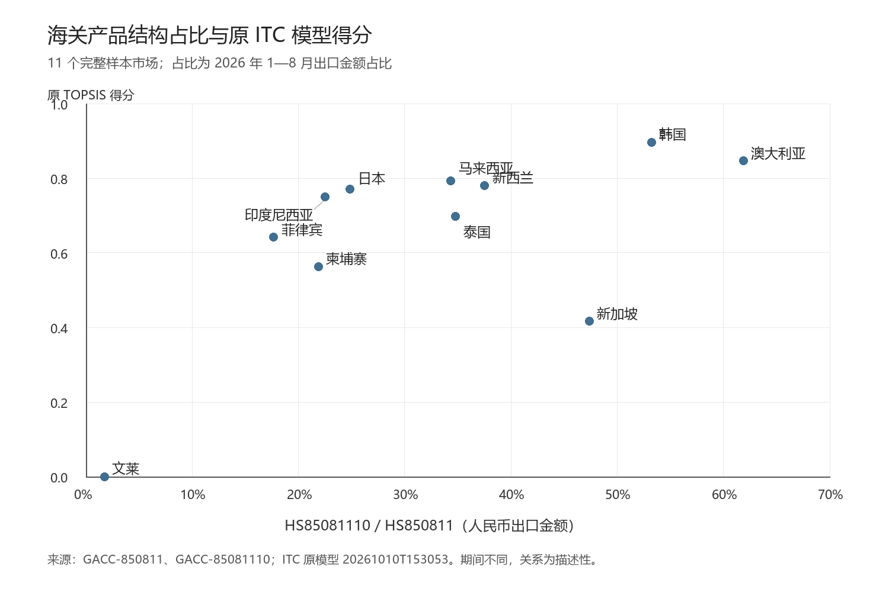
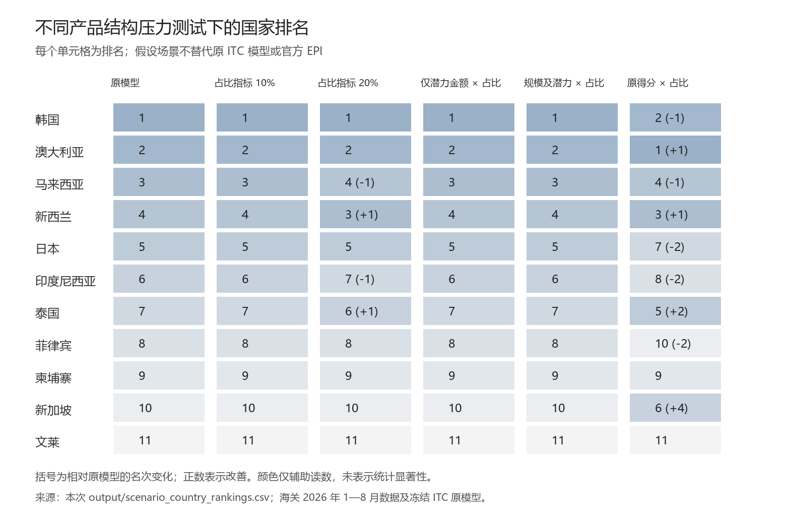

# HS85081110 占比对 ITC 国家排名的影响

## 结论

在现有五指标 TOPSIS 方法下，产品结构差异没有改变本轮前五名市场的选择。将海关占比用于金额指标的压力调整后，11 国排序全部保留；把占比作为第六项指标、赋予 20% 权重时，前五仍是韩国、澳大利亚、新西兰、马来西亚和日本，只是新西兰与马来西亚互换位置。

但这不等于“产品范围差异可以忽略”。若直接用占比乘原得分，或给予占比更高的评分权重，日本会被泰国替换。因此，可以保留现有五国深入研究范围，同时将日本作为边界敏感市场、泰国作为备选市场。现有数据不能证明哪一种压力场景就是扫地机器人的真实市场排序。[V-020—V-023]

## 1. 本次验证用什么数据

占比是中国海关 2026 年 1—8 月的**出口金额占比**，不是台数占比。原始 HS850811 表没有数量字段，两张表共有的是人民币金额。按国家汇总各注册地和贸易方式后，以 HS85081110 金额除以 HS850811 金额；所有占比都从原始整数金额重算，并与已有占比表核对。[GACC-850811；GACC-85081110]

ITC 原模型包含 11 个完整样本市场。越南、老挝、缅甸有海关占比，但原模型缺主指标，未生成其名次；美国只作为海关参照。结论适用于这 11 国，不代表已经检验全部 RCEP 市场。[V-001]

原模型在本次验证中原样复现：得分与归档结果的最大误差为 0，名次全部一致，独立标量实现误差也小于 `1e-12`。原始数据与原模型未被替换。[V-002]

## 2. 占比是否与原得分、原名次相关

| 检验 | 占比与原得分的系数 | 双侧置换 p 值 | 三项 Holm 校正 p 值 |
|---|---:|---:|---:|
| Pearson | 0.6262 | 0.03910 | 0.08025 |
| Spearman | 0.6545 | 0.03430 | 0.08025 |
| Kendall tau-b | 0.5273 | 0.02675 | 0.08025 |

199,999 次随机置换，样本量 11。Kendall 无并列精确检验 p=0.02638，与置换结果接近。占比高的国家整体上也有较高原模型得分。单项检验在 5% 水平有信号，三项校正后不再达到 5%；这支持“存在正向共变迹象”，不支持“占比决定排名”。[V-010—V-013]

若直接以原名次为变量，Pearson=-0.6679、Spearman=-0.6545、Kendall=-0.5273。负号来自名次越小越好，不能理解为占比越高吸引力越低。详细 p 值另存于 `share_vs_numeric_rank.csv`，六项整体校正另存于 `multiple_testing_six_tests.csv`。[V-014]

相关性还受国家构成影响。剔除文莱后，Pearson 从 0.6262 降至 0.2928；剔除新加坡则升至 0.7811。Pearson 的国家重抽样 95% 百分位区间为 [-0.2318, 0.9066]，其他两种方法的区间也跨过零。区间用于展示这组小样本的构成敏感性，不是未来市场的预测区间。因此，排名影响要继续用情景计算检验，不能只看相关系数或 p 值。[V-015—V-016]

图源：两份海关原始文件、原 ITC 得分表及本次 `input/matched_model_inputs.csv`。海关占比是 2026 年 1—8 月，原模型贸易指标主要是 2025 年，关系为描述性比较。

## 3. 纳入占比后，排名实际改变多少

| 处理方式 | 原/新名次 Spearman | Kendall | 最大名次变化 | 前五保留数 | 前五排序 |
|---|---:|---:|---:|---:|---|
| 原模型 | 1.0000 | 1.0000 | 0 | 5/5 | 韩、澳、马、新、日 |
| 占比作为第六指标，权重 5% | 1.0000 | 1.0000 | 0 | 5/5 | 韩、澳、马、新、日 |
| 占比作为第六指标，权重 10% | 1.0000 | 1.0000 | 0 | 5/5 | 韩、澳、马、新、日 |
| 占比作为第六指标，权重 20% | 0.9818 | 0.9273 | 1 | 5/5 | 韩、澳、新、马、日 |
| 未实现潜力金额代理值乘占比，重跑原算法 | 1.0000 | 1.0000 | 0 | 5/5 | 韩、澳、马、新、日 |
| 进口规模与潜力金额代理值同时乘占比，重跑原算法 | 1.0000 | 1.0000 | 0 | 5/5 | 韩、澳、马、新、日 |
| 占比作为第六指标，权重 40% | 0.8364 | 0.6727 | 4 | 4/5 | 澳、韩、新、马、泰 |
| 原得分直接乘占比 | 0.8364 | 0.6727 | 4 | 4/5 | 澳、韩、新、马、泰 |

表中“新”为新西兰。各情景的精确得分、名次、国家对逆序数、前三/前五重合度和全部中间量已分别保存。[V-020—V-022]

金额调整均发生在 `log1p` 和标准化之前。占比用于进口规模、潜力金额的前提，是假设中国出口产品结构能够迁移到这些指标；目前没有直接数据证明这一点，所以表中只称代理场景，不称官方窄编码需求或 EPI。仅调整潜力金额的场景保留原潜力比例，改变的是评分代理，而非重估整套官方潜力指标。

用 `s^α` 调整金额、α 在 0—2 按 0.005 步长变化的两类场景中，均未触发前五成员变化。新增占比指标的权重 λ 从 0—50% 扫查时，前五成员首次在 λ=25.0% 的网格点发生变化：泰国进入、日本退出；24.5% 的前一网格点仍未变化。这个区间是当前算法下的敏感边界，不是建议采用的权重。[V-023]

图源：本次 `output/scenario_country_rankings.csv`。括号为相对原模型的名次变化，正数表示改善。

## 4. 各重点市场应怎样理解

| 市场 | 出口金额占比 | 原名次 | 原得分乘占比后的名次 | 对后续研究的含义 |
|---|---:|---:|---:|---|
| 韩国 | 53.22% | 1 | 2 | 占比较高，所有已测情景中仍处于前列 |
| 澳大利亚 | 61.88% | 2 | 1 | 在原前五中占比最高，强化结构偏好时上升 |
| 马来西亚 | 34.34% | 3 | 4 | 前五资格保留，新增指标 20% 时与新西兰互换 |
| 新西兰 | 37.53% | 4 | 3 | 占比高于马来西亚，强化结构偏好时相对上升 |
| 日本 | 24.85% | 5 | 7 | 在原前五中占比最低，强结构惩罚时跌出前五 |
| 泰国 | 34.78% | 7 | 5 | 是第五名替换的直接备选，值得保留比较 |

占比来自本次原始金额汇总，情景名次来自本次计算。[S-KOR；S-AUS；S-MYS；S-NZL；S-JPN；S-THA；V-022]

日本并不是因占比较低就必然失去市场价值。保留原算法、同时调整规模和潜力金额后，日本得分由 0.770295 降为 0.758712，仍为第五；原第六印度尼西亚得分也从 0.750149 降至 0.733959。真正导致日本退出前五的是对产品结构赋予更强影响的情景，而不是已观察到的窄编码进口需求下降。[V-024]

原模型的金额指标经过对数压缩，再在共同样本标准化，因而比例折减不会一比一传递到最终分数。文莱的规模极小，文莱、新加坡的未实现潜力为零，也影响了标准化区间。原方法下稳定，部分反映这种计算结构，不应被写成“海关编码差异已被证明不重要”。具体变换可从 `intermediate/scenario_matrices.csv` 逐项检查。[V-025]

## 5. 同期海关数据还能直接验证什么

不借用任何 ITC 指标，直接比较 14 个 RCEP 目的地同期的宽/窄编码出口金额排名，Spearman=0.9780、Kendall=0.9121。多数国家次序相近，但头部顺序发生变化：宽编码为日本、韩国、澳大利亚，窄编码为澳大利亚、韩国、日本。日本从第一降至第三，澳大利亚从第三升至第一。[V-030]

这是一项真实观察到的出口结构差异。它说明头部规模判断需要使用窄编码资料；但出口额排名只回答中国目前向哪里卖得多，不能替代同时衡量增长、需求和潜力的市场吸引力排名。

## 6. 建议

1. 保留现有五国作为深入研究对象，正文将结果准确称为“HS850811 贸易口径下的初筛，并经 HS85081110 出口金额结构压力测试”。不能改称已经得到扫地机器人专属的官方 EPI 排名。
2. 在后续比较表中并列放入原 TOPSIS 名次、海关窄编码出口金额、金额占比和情景名次。占比是产品结构信息，不是可以直接乘到该国全部需求上的通用折扣。
3. 对日本增加窄编码需求、终端品牌竞争和渠道证据；同时保留泰国作为边界备选。是否调整第五名，应由新增的产品级证据决定，不用人为选择的权重反推结论。
4. 越南占比为 68.27%，但本轮缺完整 ITC 主指标，不能因没有名次而被解释为吸引力低。若扩展候选范围，优先补齐越南的同口径需求和竞争数据，而不是直接把高占比当作高潜力。[S-VNM]
5. 后续取得同年度或多年度的窄编码数据后，再检查占比的时间稳定性。2026 年部分年度的出口结构只能给现有宽编码模型提供一组截面压力参数。

## 引用方式

计算事实以本目录 `metadata/fact_registry.csv` 的 `fact_id` 定位；海关原始行以 `metadata/customs_row_lineage.csv` 定位；ITC 官方事实以 `metadata/official_itc_source_ledger.csv` 和原模型字段追溯表定位。访问日期未知的海关材料应注明“用户提供的海关导出文件，下载日期未记录”，不补写 2026-10-10 为官方网站访问日。

建议引用标签：`[HS85081110-ITC验证，20261010-HS85081110-share-ITC-ranking-verification，fact_id]`。本文件为验证说明，不直接写入或改写比赛报告。
